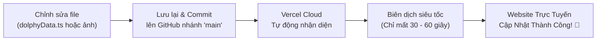

# DOLPHY CAFÉ & ACADEMY - HỆ THỐNG WEBSITE & CẨM NANG VẬN HÀNH 2026 🐬☕

> **Website Chính Thức Của Hệ Sinh Thái Cà Phê Dolphy Café - Dolphy Academy & Specialty Roastery**  
> Kế thừa di sản 13 năm (2013 - 2026, Top 10 Saigon Coffee) kết hợp chuyển đổi số: Học viện đào tạo Barista thực chiến, Cửa hàng cà phê mộc rang xay và Hệ thống quản trị nội bộ (Admin CRM).  
> 🔗 **Website Trực Tuyến**: [https://dolphycafe.vercel.app](https://dolphycafe.vercel.app)  
> 🛡️ **Cổng Quản Trị Nội Bộ (CRM Bí Mật)**: [https://dolphycafe.vercel.app/admin](https://dolphycafe.vercel.app/admin)

---

## 📑 MỤC LỤC TỔNG QUAN

1. [Nhận Diện Thương Hiệu (Brand Identity)](#1-nhận-diện-thương-hiệu-brand-identity)
2. [Hệ Thống Bảng Màu Chuẩn & Bộ 5 Theme Thiết Kế (5 Distinct Themes)](#2-hệ-thống-bảng-màu-chuẩn--bộ-5-theme-thiết-kế-5-distinct-themes)
3. [Quy Chuẩn Font Chữ & Typography](#3-quy-chuẩn-font-chữ--typography)
4. [Tiêu Chuẩn Thiết Kế & Trải Nghiệm Người Dùng (UI/UX)](#4-tiêu-chuẩn-thiết-kế--trải-nghiệm-người-dùng-uiux)
5. [Kiến Trúc Kỹ Thuật & Công Nghệ (Technical Stack)](#5-kiến-trúc-kỹ-thuật--công-nghệ-technical-stack)
6. [Cấu Trúc Thư Mục Dự Án](#6-cấu-trúc-thư-mục-dự-án)
7. [CẨM NANG QUẢN LÝ WEBSITE DÀNH CHO NGƯỜI KHÔNG RÀNH KỸ THUẬT](#7-cẩm-nang-quản-lý-website-dành-cho-người-không-rành-kỹ-thuật)
   - 7.1. Hướng dẫn sử dụng Cổng Quản Trị CRM (`/admin`)
   - 7.2. Quản lý Đăng ký Khóa học Academy & Phễu Tuyển sinh 6 Giai đoạn
   - 7.3. Quản lý Đơn hàng Cà phê Gói (Shop Roastery)
   - 7.4. Quản lý Hồ sơ Tuyển dụng & Ứng viên (Careers)
   - 7.5. Hướng dẫn Chỉnh sửa Menu, Giá tiền, Chi nhánh, Bài viết (File `dolphyData.ts`)
   - 7.6. Hướng dẫn Thay đổi Hình ảnh & Tối ưu dung lượng
   - 7.7. Quy trình Cập nhật Website Tự động (GitHub ➔ Vercel Auto Deploy)
   - 7.8. Cấu hình Tài khoản Ngân hàng Chuyển khoản & Mã VietQR
   - 7.9. Hướng dẫn Khắc phục Sự cố Thường gặp (FAQ / Troubleshooting)
   - 7.10. Hướng dẫn Sử dụng & Cài đặt Ứng dụng Progressive Web App (PWA)
8. [Cài Đặt & Chạy Cục Bộ (Dành Cho Lập Trình Viên)](#8-cài-đặt--chạy-cục-bộ-dành-cho-lập-trình-viên)
9. [Bản Quyền & Thông Tin Liên Hệ](#9-bản-quyền--thông-tin-liên-hệ)

---

## 1. NHẬN DIỆN THƯƠNG HIỆU (BRAND IDENTITY)

* **Tên thương hiệu**: Dolphy Café & Dolphy Academy
* **Câu khẩu hiệu (Slogan)**: *"Happiness in a cup"* (Hạnh phúc trong từng tách cà phê)
* **Thông điệp cốt lõi**: *"My name's DOLPHY. I'm a dolphin. I only serve pure coffee."*
* **Biểu tượng (Icon)**: Chú cá heo thông minh, thân thiện, vui vẻ và nhanh nhẹn. Tượng trưng cho tinh thần của các Barista Dolphier luôn kết nối và mang niềm vui đến khách hàng.
* **Di sản thương hiệu**: Thành lập ngày **20/10/2013** tại Thảo Điền (Quận 2, nay là TP. Thủ Đức). Từng được tạp chí ẩm thực - du lịch uy tín *Words* bình chọn là 1 trong 10 quán cà phê đáng uống nhất TP.HCM liên tiếp các năm 2015, 2016, 2017.
* **Quy mô chuỗi**: 10 chi nhánh phục vụ tại các khu vực sầm uất: Thảo Điền (Quận 2), Phú Mỹ Hưng (Quận 7), Bình Thạnh và Quận 3.
* **Phong cách ngôn ngữ (Tone of Voice)**: Trẻ trung, chuyên nghiệp, ấm áp, gần gũi, đam mê cà phê mộc nguyên bản và đề cao kỹ năng thực chiến.

---

## 2. HỆ THỐNG BẢNG MÀU CHUẨN & BỘ 5 THEME THIẾT KẾ (5 DISTINCT THEMES)

Mọi thành phần giao diện trên website đều tuân thủ nghiêm ngặt bảng mã màu thương hiệu đã được chuẩn hóa:

| Vai Trò Màu Sắc | Tên Gọi | Mã HEX | Mã RGB | Hướng Dẫn Ứng Dụng Thực Tế |
| :--- | :--- | :--- | :--- | :--- |
| **Màu Nhận Diện Chủ Đạo** | **Dolphy Ocean Blue** | `#2076bd` | `rgb(32, 118, 189)` | Màu thương hiệu cốt lõi: Nút bấm chính, tiêu đề phân mục lớn, thanh Header, icon nổi bật, tab đang chọn, đường viền kích hoạt. |
| **Xanh Đậm (Hover / Gradient)** | **Dolphy Dark Blue** | `#165b94` | `rgb(22, 91, 148)` | Trạng thái hover của nút bấm xanh, dải chuyển màu (gradient) ở các banner Hero, chân trang Footer. |
| **Xanh Sáng (Dark Mode)** | **Dolphy Light Blue** | `#3ba0e6` | `rgb(59, 160, 230)` | Chữ tiêu đề và điểm nhấn icon khi người dùng bật chế độ Giao diện Tối (Dark Mode). |
| **Xanh Băng (Nền Nhẹ)** | **Dolphy Ice Blue** | `#f0f8ff` | `rgb(240, 248, 255)` | Khối nền nhẹ nhàng, thẻ giới thiệu tính năng, nhãn phụ dịu mắt. |
| **Màu Điểm Nhấn Nổi Bật** | **Dolphy Sunshine Amber** | `#FAEA28` | `rgb(250, 234, 40)` | Màu vàng cá heo rực rỡ: Thẻ "BÁN CHẠY", huy hiệu "ƯU ĐÃI", nút Đặt hàng / Giữ chỗ gấp, gạch chân tiêu đề, ngôi sao đánh giá. |
| **Vàng Đậm (Hover CTA)** | **Dolphy Dark Amber** | `#D4C618` | `rgb(212, 198, 24)` | Trạng thái di chuột (hover) trên các nút bấm màu vàng. |
| **Màu Chữ Chính (Light Mode)** | **Dolphy Charcoal Dark** | `#222222` | `rgb(34, 34, 34)` | Văn bản chính, tiêu đề bài viết. Độ tương phản cao êm mắt, thay thế màu đen tuyền `#000000` chống mỏi mắt. |
| **Màu Chữ Phụ / Mô Tả** | **Dolphy Neutral Gray** | `#666666` | `rgb(102, 102, 102)` | Mô tả chi tiết, ngày tháng đăng bài, số giờ học, thông tin phụ. |
| **Nền Trang Tối & Chân Trang Footer** | **Deep Slate Dark** | #0f172a | 
gb(15, 23, 42) | Màu nền toàn bộ website khi ở chế độ Dark Mode, và màu nền chuẩn của Chân trang (Footer) giúp giao diện đồng bộ, tinh tế. |
| **Khối Thẻ Tối (Dark Card)** | **Card Slate Dark** | `#1e293b` | `rgb(30, 41, 59)` | Hộp sản phẩm, khung chi nhánh, modal bài viết trong Dark Mode. |
| **Xanh Quản Trị (Admin)** | **Admin Deep Navy** | `#0b1329` | `rgb(11, 19, 41)` | Nền trang quản trị CRM chuyên biệt. |
| **Thành Công (Success)** | **Emerald Green** | `#16a34a` | `rgb(22, 163, 74)` | Trạng thái: "Đã cọc", "Đã thanh toán", "Đã tuyển", thông báo thành công. |
| **Cảnh Báo / Chờ Duyệt** | **Warning Orange** | `#f59e0b` | `rgb(245, 158, 11)` | Trạng thái: "Chờ liên hệ", "Chờ đặt cọc", "Đang xử lý". |
| **Hủy Bỏ / Lỗi (Error)** | **Rose Red** | `#ef4444` | `rgb(239, 68, 68)` | Trạng thái: "Đã hủy", "Hết hàng", thông báo lỗi. |

---

### 2.2. BỘ 5 PHONG CÁCH THIẾT KẾ GIAO DIỆN RIÊNG BIỆT (5 DISTINCT DESIGN THEMES)

Website Dolphy Café & Academy được trang bị hệ thống **5 Theme Thiết Kế Độc Lập**. Mỗi lần người dùng nhấn vào nút biểu tượng Theme trên thanh Menu, website sẽ lập tức chuyển đổi sang một phong cách thiết kế UI/UX hoàn toàn mới lạ với hệ màu, phông chữ, bo góc thẻ và hiệu ứng chuyển động riêng biệt mà toàn bộ nội dung và trang vẫn giữ nguyên:

| STT | Tên Theme | Bản Sắc Kiến Trúc | Bố Cục Header & Thanh Menu | Bố Cục Footer (Chân Trang) | Hình Khối & Nút Bấm | Phông Chữ Đặc Trưng |
| :---: | :--- | :--- | :--- | :--- | :--- | :--- |
| **1** | 🌊 **Di Sản Biển Xanh** <br>*(Ocean Heritage)* | Corporate Di Sản 2013 kinh điển của Dolphy Thảo Điền. | **Thanh Menu 2 Tầng Cổ Điển**: Tầng trên chứa Logo, Tìm kiếm, Hotline & Giỏ hàng; tầng dưới là thanh Sticky Navigation ngang. | **Chân Trang 4 Cột Cân Bằng**: Cột nhận diện thương hiệu, 10 Chi nhánh, Hệ sinh thái & Form đăng ký nhận tin. | Nút chữ nhật bo góc vừa vặn (`rounded-md` 6px), thẻ chuẩn `rounded-xl`. | Phông **Oswald** kết hợp **Montserrat** hiện đại, thanh thoát. |
| **2** | 🌙 **Xưởng Rang Đêm** <br>*(Midnight Roastery)* | Cyber Lounge vị lai cho tín đồ cà phê đặc sản về đêm. | **Đảo Nổi Cyber Capsule (Floating Glass)**: Thanh Header lơ lửng giữa màn hình, viền Neon Cyan phát sáng kèm nhịp xung telemetry `ONLINE 2026 // NODE 01`. | **Terminal HUD Footer**: Thanh trạng thái thời gian thực `[STATUS: OPTIMAL]`, các phím mạng xã hội HUD `[FB] [IG] [TT]`, nút lệnh Dispatch dạ quang. | Nút bấm dạ quang Cyber-pill viền Neon, thẻ Kính Mờ (Glassmorphism) phát quang khi hover. | Phông Oswald vi tính + font Mono thời gian thực. |
| **3** | 🌿 **Vườn Cổ Điển Thảo Điền** <br>*(Botanical Courtyard)* | Biệt thự Pháp sân vườn cổ kính & văn phong học thuật. | **Tòa Soạn Cổ Điển (Centered Masthead)**: Dải ruy-băng `EST. 2013` trên đỉnh, Logo đặt **chính giữa trang trọng**, menu cân xứng hai bên có hoa văn `❦`. | **Broadside Gazette Footer**: Khối trích dẫn danh ngôn văn học trung tâm, 3 cột báo chí truyền thống, hoa văn cổ điển Pháp. | Khung thẻ viền chỉ giấy mộc thủ công (`rounded-sm` 6px), nút bấm ngọc bích viền kép. | Toàn bộ tiêu đề lớn, Menu và Hero chuyển sang **Playfair Display (Serif)** quý phái. |
| **4** | 📐 **Tối Giản Bắc Âu** <br>*(Nordic Minimalist)* | Studio kiến trúc Bắc Âu & phong cách Pour-over tối giản. | **Dải Băng Siêu Mảnh (Ultra-Slim Strip)**: Chiều cao tối giản 64px, các liên kết ngăn cách bằng dấu gạch chéo `/`, nút thẻ góc vuông tuyệt đối. | **Swiss Typographic Index Footer**: Header chữ lớn cực đại `DOLPHY / ARCHIVE`, bảng mục lục số hóa `[01 / DIRECTORY]`, `[02 / STATIONS]`. | **Góc nhọn tuyệt đối 0px (No-radius)** khắp toàn bộ nút bấm, thẻ sản phẩm, ô nhập liệu. | Phông Oswald All-caps kéo giãn khoảng cách chữ rộng (tracking-widest). |
| **5** | 🌅 **Hoàng Hôn Sài Gòn** <br>*(Sunset Saigon)* | Nắng chiều tà rực rỡ bên sông Sài Gòn & phong cách sống tươi trẻ. | **Đảo Nổi Viên Sỏi (Floating Pebble Island)**: Thanh Header viên thuốc bo cong toàn diện (`rounded-full`), tab đang chọn là viên sỏi san hô rực rỡ. | **Vòm Sóng Nhiệt Đới (Curved Wave Footer)**: Đỉnh chân trang uốn lượn cong mềm (`rounded-t-[48px]`), thẻ chào đón cộng đồng lơ lửng, form sỏi bầu bĩnh. | Nút bấm dạng **Viên Thuốc Hoàn Toàn (`rounded-full`)**, thẻ bo sỏi siêu lớn (`rounded-3xl` 28px). | Tiêu đề chuyển sắc Gradient Coral-Orange, huy hiệu cam rực rỡ. |

* **Cách chuyển đổi**:
  - **Nhấn 1 chạm**: Bấm vào nút Theme trên thanh Header (hoặc menu di động) để chuyển tiếp xoay vòng qua 5 theme.
  - **Rê chuột (Desktop)**: Rê chuột vào nút Theme để mở bảng chọn 5 theme trực quan kèm chấm màu đại diện.
  - **Ghi nhớ thông minh**: Lựa chọn theme của bạn được tự động lưu vào trình duyệt (`localStorage`) và áp dụng nhất quán trên tất cả các trang.

---

## 3. QUY CHUẨN FONT CHỮ & TYPOGRAPHY

Dự án sử dụng Google Fonts nhúng trực tiếp tại `index.html`, tối ưu hiển thị 100% tiếng Việt có dấu:

### 3.1. Font Tiêu Đề Chính: `Oswald`
* **Khai báo CSS**: `font-family: 'Oswald', sans-serif;`
* **Đặc tính**: Chữ cô đọng (condensed), viết hoa (UPPERCASE), dứt khoát, mang tinh thần thương hiệu di sản từ 2013 của Dolphy.
* **Ứng dụng**: Toàn bộ tiêu đề trang (H1, H2, H3), tên sản phẩm, tên khóa học, số liệu thống kê nổi bật, nút bấm CTA (chữ in hoa, `letter-spacing: 0.5px - 1px`).
* **Độ đậm (Font Weight)**: `500` (Medium), `600` (Semi-bold), `700` (Bold).

### 3.2. Font Nội Dung Thân: `Montserrat`
* **Khai báo CSS**: `font-family: 'Montserrat', system-ui, -apple-system, sans-serif;`
* **Đặc tính**: Hình học (geometric sans), nét tròn trịa, hiện đại, cực kỳ dễ đọc trên màn hình điện thoại và máy tính bảng.
* **Ứng dụng**: Đoạn văn bản mô tả, nội dung bài viết, bảng giá, biểu mẫu điền thông tin, địa chỉ chi nhánh.
* **Độ đậm (Font Weight)**: `400` (Regular), `500` (Medium), `600` (Semi-bold).

### 3.3. Font Kể Chuyện & Di Sản: `Playfair Display` & `Lora`
* **Khai báo CSS**: `font-family: 'Playfair Display', 'Lora', Georgia, serif;`
* **Đặc tính**: Font có chân (Serif) sang trọng, giàu tính điện ảnh và cảm xúc.
* **Ứng dụng**: Các câu châm ngôn, trích dẫn triết lý thương hiệu, câu chuyện 13 năm di sản Sài Gòn.

---

## 4. TIÊU CHUẨN THIẾT KẾ & TRẢI NGHIỆM NGƯỜI DÙNG (UI/UX)

* **Thiết Kế Mobile-First Đáp Ứng Mọi Thiết Bị**: Tối ưu hoàn hảo từ màn hình điện thoại nhỏ (375px), iPhone Pro Max (430px), iPad (768px - 1024px) đến màn hình máy tính lớn (1920px+).
* **Video Hero Tinh Gọn & Đẹp Mắt**:
  - Tự động chạy nền không giật (`autoplay`, `loop`, `muted`, `playsinline`).
  - Cắt tràn viền điện ảnh để che khoảng viền đen, tạo cảm giác sang trọng.
  - Tích hợp nút chạm để bật/tắt tiếng tinh tế, không chèn bất kỳ lớp quảng cáo rối mắt nào.
* **Hiệu Ứng Cuộn Mượt Mà Chuẩn 60fps/120fps (Hardware-Accelerated)**:
  - Chỉ sử dụng phần cứng GPU composite (`transform: translate3d(...)` và `opacity`).
  - **Tuyệt đối không dùng `filter: blur()` khi cuộn** để triệt tiêu 100% hiện tượng giật hình (lag/jank).
  - Đường cong chuyển động chuẩn của Apple: `0.85s cubic-bezier(0.16, 1, 0.3, 1)`.
  - Nhịp sóng xuất hiện phân tầng (stagger delay) nối đuôi nhau `90ms` tự nhiên.
  - Sử dụng `IntersectionObserver` bất đồng bộ, loại bỏ hoàn toàn việc tính toán vị trí gây nghẽn khung hình.
* **Độc Lập Toạ Độ Cho Cửa Sổ Modal (`createPortal`)**:
  - Tất cả các modal đọc bài viết, xem ảnh phóng to, xem nhanh sản phẩm đều dùng `createPortal(..., document.body)` để luôn hiển thị ngay giữa màn hình độc lập với thanh cuộn trang.
  - Tự động khoá thanh cuộn trang chính (`overflow: hidden`) khi đang mở modal.
  - Hỗ trợ bấm vùng nền đen mờ (backdrop) hoặc phím `Esc` để đóng nhanh.
* **Chế Độ Sáng / Tối (Light & Dark Mode)**: Hỗ trợ chuyển đổi nhanh chỉ bằng 1 nút bấm (biểu tượng Mặt Trời / Mặt Trăng) và tự ghi nhớ lựa chọn của khách qua `localStorage`.
* **Song Ngữ Hoàn Chỉnh (Tiếng Việt / English)**: Chuyển đổi ngôn ngữ tức thì không cần tải lại trang.

---

## 5. KIẾN TRÚC KỸ THUẬT & CÔNG NGHỆ (TECHNICAL STACK)

| Công Nghệ | Phiên Bản | Mục Đích Sử Dụng |
| :--- | :--- | :--- |
| **React** | `19.0.0` | Thư viện giao diện chính, tối ưu hóa xử lý render và hiệu suất cao. |
| **Vite** | `6.2.0` | Công cụ đóng gói mã nguồn siêu tốc, khởi động máy chủ thử nghiệm dưới 300ms. |
| **TypeScript** | `5.7.2` | Ngôn ngữ gõ tĩnh giúp kiểm soát lỗi dữ liệu, đảm bảo website không gặp lỗi bất ngờ. |
| **Tailwind CSS** | `v4.0` | Framework tạo kiểu dáng giao diện với hệ thống class tiện ích hiện đại. |
| **React Router** | `v7.2.0` | Điều hướng trang mượt mà chuẩn Single Page Application (SPA), không bị chớp giật khi chuyển trang. |
| **Lucide React** | `v0.475.0` | Bộ biểu tượng đồ họa vector SVG sắc nét, dung lượng siêu nhẹ. |
| **VietQR Napas247** | API v2 | Tự động tạo mã QR chuyển khoản ngân hàng chuẩn Quốc gia kèm số tiền và mã hóa đơn. |
| **Vercel** | Edge Network | Nền tảng máy chủ đám mây toàn cầu, tự động triển khai mã nguồn khi cập nhật GitHub. |

---

## 6. CẤU TRÚC THƯ MỤC DỰ ÁN

```text
DOLPHY WEBSITE/
├── public/                     # Thư mục tĩnh, logo, video, favicon & tài sản PWA
│   ├── favicon.ico             # Icon hiển thị trên tab trình duyệt
│   ├── favicon.png             # Icon độ phân giải cao cho điện thoại
│   ├── manifest.webmanifest    # Cấu hình W3C Web App Manifest cho Progressive Web App
│   ├── manifest.json           # Cấu hình tương thích Manifest chuẩn
│   ├── sw.js                   # Service Worker xử lý bộ nhớ đệm Offline & tăng tốc tải trang
│   ├── icons/                  # Bộ biểu tượng ứng dụng PWA (192x192, 512x512, maskable)
│   ├── dolphy-hero-loop.mp4    # Video chạy nền trang chủ
│   └── images/                 # Kho ảnh sản phẩm, chi nhánh, học viện
├── src/
│   ├── components/             # Các khối giao diện dùng chung
│   │   ├── pwa/                # Các thành phần Progressive Web App
│   │   │   ├── PwaInstallPrompt.tsx    # Banner mời cài đặt App & hướng dẫn iOS Safari
│   │   │   ├── OfflineIndicator.tsx    # Thanh thông báo trạng thái khi mất kết nối mạng
│   │   │   └── PwaUpdateNotification.tsx # Hộp thông báo cập nhật phiên bản mới
│   │   ├── Navbar.tsx          # Thanh điều hướng đầu trang (Logo, Menu, Nút Cài App, Giỏ hàng)
│   │   ├── Footer.tsx          # Chân trang (Thông tin pháp lý, Địa chỉ chi nhánh, Mạng xã hội)
│   │   ├── CartDrawer.tsx      # Ngăn kéo giỏ hàng trượt từ phải sang
│   │   ├── CheckoutModal.tsx   # Cửa sổ thanh toán giỏ hàng kèm mã VietQR
│   │   ├── CourseRegisterModal.tsx # Cửa sổ đăng ký học Barista kèm mã VietQR đặt cọc
│   │   ├── ApplicationModal.tsx# Cửa sổ ứng tuyển việc làm trực tuyến
│   │   ├── BackToTop.tsx       # Nút cuộn nhanh lên đầu trang
│   │   └── Toast.tsx           # Hộp thông báo nổi (Thêm giỏ hàng thành công, v.v.)
│   ├── context/
│   │   └── DolphyContext.tsx   # "Bộ não" lưu trữ trạng thái Giỏ hàng, Đơn hàng, Ngôn ngữ, PWA
│   ├── data/
│   │   └── dolphyData.ts       # ⭐ FILE DỮ LIỆU CHÍNH: Nơi sửa Menu, Giá tiền, Chi nhánh, Khóa học
│   ├── hooks/
│   │   └── useScrollReveal.ts  # Bộ kích hoạt hiệu ứng cuộn mượt mà không giật
│   ├── i18n/
│   │   └── translations.ts     # Từ điển Song ngữ (Tiếng Việt & Tiếng Anh)
│   ├── pages/                  # Các trang hiển thị chính của website
│   │   ├── Home.tsx            # Trang Chủ (Hero Video, 13 Năm Di Sản, Khóa học, Sản phẩm, Thư viện)
│   │   ├── Academy.tsx         # Trang Học Viện Barista Thực Chiến (Lộ trình 6 buổi, Lịch học, Học phí)
│   │   ├── Shop.tsx            # Cửa hàng Cà phê Hạt & Dụng cụ Pha chế
│   │   ├── Branches.tsx        # Bản đồ & Danh sách 10 Chi nhánh (Có bộ lọc Quận & Giờ mở cửa)
│   │   ├── KnowledgeHub.tsx    # Cẩm nang Cà phê & Tin tức (Kèm cửa sổ đọc bài viết)
│   │   ├── Careers.tsx         # Tuyển dụng Barista & Ca trưởng
│   │   ├── About.tsx           # Câu chuyện Thương hiệu & Tầm nhìn
│   │   ├── Policies.tsx        # Chính sách Đổi trả, Bảo mật & Giao hàng
│   │   └── AdminDashboard.tsx  # ⭐ TRANG QUẢN TRỊ NỘI BỘ (CRM NỘI BỘ)
│   ├── pwa/
│   │   └── pwaService.ts       # Quản lý sự kiện cài đặt PWA, Service Worker & trạng thái mạng
│   ├── types/
│   │   └── index.ts            # Định nghĩa cấu trúc dữ liệu chuẩn (TypeScript Interfaces)
│   ├── App.tsx                 # Cấu hình đường dẫn URL, bố cục tổng thể & PWA notifications
│   ├── index.css               # Định nghĩa màu sắc, font chữ và hiệu ứng chuyển động
│   └── main.tsx                # Điểm khởi đầu của ứng dụng React & Đăng ký Service Worker
├── index.html                  # Khung HTML gốc, nhúng font chữ và thẻ SEO
├── package.json                # Danh sách thư viện và tập lệnh build
└── README.md                   # ⭐ CẨM NANG HƯỚNG DẪN NÀY
```

---

## 7. CẨM NANG QUẢN LÝ WEBSITE DÀNH CHO NGƯỜI KHÔNG RÀNH KỸ THUẬT

Phần này được biên soạn đặc biệt dành cho Quản lý cửa hàng, Trưởng phòng Marketing hoặc Chủ thương hiệu để có thể dễ dàng quản trị, theo dõi đơn hàng và cập nhật nội dung website mà không cần biết viết code.

---

### 7.1. Hướng Dẫn Sử Dụng Cổng Quản Trị CRM (`/admin`)

Website được tích hợp sẵn một hệ thống CRM chuyên nghiệp chạy trực tiếp trên trình duyệt, không cần cài đặt phần mềm bên ngoài:

* **Đường dẫn truy cập**: Bạn chỉ cần thêm `/admin` vào sau địa chỉ web.  
  👉 Ví dụ: **`https://dolphycafe.vercel.app/admin`**
* **Tại đây, bạn có thể xem nhanh các chỉ số kinh doanh**:
  - 📊 **Doanh thu tiềm năng**: Tổng số tiền học phí và đơn hàng cà phê được gửi về hệ thống.
  - 🎓 **Tổng số học viên đăng ký**: Số lượng người đã điền form giữ chỗ khóa học Barista.
  - 🛒 **Tổng số đơn hàng**: Các đơn đặt mua cà phê hạt hoặc dụng cụ từ khách hàng.
  - 👥 **Tổng số hồ sơ ứng tuyển**: Danh sách các bạn trẻ nộp CV xin làm Barista hoặc Quản lý ca.

---

### 7.2. Quản Lý Học Viên Đăng Ký Academy & Phễu Tuyển Sinh

Khi khách hàng bấm *"ĐĂNG KÝ GIỮ CHỖ"* trên trang Học viện, dữ liệu sẽ ngay lập tức được gửi vào CRM tại tab **"Học Viên Academy"**:

1. **Xem thông tin chi tiết**: Bạn sẽ thấy Tên học viên, Số điện thoại, Email, Khóa học mong muốn, Ca học đã chọn, và Số tiền cọc (2.000.000đ).
2. **Theo dõi 6 giai đoạn tư vấn (Quy trình chuẩn)**:
   - 🟡 **Mới đăng ký (`pending`)**: Học viên vừa gửi thông tin trên web, chưa gọi điện tư vấn.
   - 🔵 **Đã liên hệ (`contacted`)**: Tư vấn viên đã gọi điện thoại/Zalo để giải đáp thắc mắc.
   - 🟠 **Chờ cọc (`waiting_deposit`)**: Học viên hẹn ngày chuyển tiền cọc 2 triệu giữ chỗ.
   - 🟢 **Đã cọc (`deposited`)**: Kế toán đã nhận được tiền cọc qua tài khoản ngân hàng.
   - 🟣 **Đã đóng đủ (`paid_full`)**: Học viên đã hoàn tất 100% học phí trước ngày khai giảng.
   - 🎓 **Đang học / Đã tốt nghiệp (`studying` / `graduated`)**: Học viên đang thực hành tại quầy bar Dolphy.
3. **Cập nhật trạng thái**: Bạn chỉ cần nhấp chuột vào ô trạng thái của học viên đó và chọn bước tiếp theo.
4. **Xuất danh sách ra Excel / CSV**: Bấm nút **"Xuất Dữ Liệu" (Download CSV)** ở góc trên để tải file danh sách học viên về máy, mở trực tiếp bằng Microsoft Excel để gửi cho Giảng viên hoặc Kế toán.

---

### 7.3. Quản Lý Đơn Hàng Cà Phê Gói (Shop Roastery)

Tại tab **"Đơn Hàng Shop"**:
* Hiển thị danh sách khách đặt mua: Tên người nhận, Số điện thoại, Địa chỉ giao hàng, Tên sản phẩm, Độ mịn hạt cần xay (Nguyên hạt, Xay Pha Phin, Xay Cold Brew, Xay V60), và Tổng tiền.
* Cập nhật tiến độ giao: **Chờ xác nhận ➔ Đang đóng gói ➔ Đang giao hàng ➔ Hoàn thành**.
* **Lưu ý**: Đối với các món nước pha chế uống ngay (Ly mang đi), website tự động chuyển hướng khách sang hệ sinh thái giao hàng tận nơi **CukCuk** của Dolphy để nhân viên cửa hàng gần nhất nhận đơn in bill ngay lập tức.

---

### 7.4. Quản Lý Hồ Sơ Tuyển Dụng & Ứng Viên (Careers)

Tại tab **"Hồ Sơ Tuyển Dụng"**:
* Xem danh sách ứng viên xin việc: Họ tên, Năm sinh, Vị trí (Barista Full-time / Part-time / Ca trưởng), Chi nhánh muốn làm việc, Kinh nghiệm trước đây.
* **Xem CV**: Bấm vào liên kết CV đính kèm để mở hồ sơ năng lực của ứng viên.
* Đổi trạng thái tuyển dụng: **Chờ duyệt ➔ Đã liên hệ ➔ Hẹn phỏng vấn ➔ Trúng tuyển ➔ Từ chối**.

---

### 7.5. Hướng Dẫn Chỉnh Sửa Menu, Giá Tiền, Chi Nhánh, Bài Viết

Toàn bộ nội dung hiển thị trên website được quản lý tập trung tại duy nhất một file:  
📁 **`src/data/dolphyData.ts`**

Bạn có thể mở file này bằng ứng dụng **Notepad**, **Visual Studio Code** hoặc trực tiếp trên **GitHub.com**:

#### Ví dụ 1: Thay đổi Số điện thoại Hotline hoặc Email của Dolphy
Tìm đoạn mã `brandInfo` ở đầu file và sửa chữ trong dấu ngoặc kép:
```typescript
export const brandInfo = {
  name: 'Dolphy Café & Coffee Hub',
  slogan: 'Happiness in a cup',
  hotline: '0938 084 985',          // <-- Sửa số điện thoại mới tại đây
  email: 'contact@dolphycafe.com',   // <-- Sửa email mới tại đây
  ...
};
```

#### Ví dụ 2: Thay đổi Giá tiền hoặc Tên Khóa Học Barista
Tìm đến phần `coursesData`, tìm khóa học cần sửa:
```typescript
{
  id: 'barista-thuc-chien',
  title: 'Khóa Học Barista Thực Chiến Dolphy',
  price: 8000000,          // <-- Giá gốc (ví dụ 8.000.000đ)
  discountPrice: 7000000,  // <-- Giá ưu đãi thực thu (ví dụ 7.000.000đ)
  depositAmount: 2000000,  // <-- Tiền cọc giữ chỗ (ví dụ 2.000.000đ)
  duration: '2 - 3 tuần',  // <-- Thời lượng khóa học
  ...
}
```

#### Ví dụ 3: Thêm hoặc Sửa Địa Chỉ Chi Nhánh
Tìm đến phần `branchesData`:
```typescript
{
  id: 'branch-10',
  name: 'Dolphy Café - Bà Huyện Thanh Quan',
  address: '08 Bà Huyện Thanh Quan, Phường Võ Thị Sáu, Quận 3, TP.HCM',
  phone: '0938 084 985',
  openHours: '07:00 - 22:00',
  mapUrl: 'https://maps.app.goo.gl/...', // Link Google Maps dẫn đường
  ...
}
```

> [!IMPORTANT]
> **Quy Tắc Vàng Khi Sửa File**:
> 1. Giữ nguyên dấu phẩy `,` ở cuối mỗi dòng.
> 2. Chữ phải luôn nằm trong cặp dấu nháy đơn `'...'` hoặc nháy kép `"..."`.
> 3. Số tiền viết liền không có dấu chấm (Ví dụ: `7000000`, không viết `7.000.000`).

---

### 7.6. Hướng Dẫn Thay Đổi Hình Ảnh & Tối Ưu Dung Lượng

Để website tải nhanh như chớp và không bị giật lag trên điện thoại:

1. **Chuẩn kích thước hình ảnh khuyến nghị**:
   - **Ảnh Banner lớn / Hero**: Tỉ lệ 16:9 (Chiều rộng 1920px, Chiều cao 1080px).
   - **Ảnh Sản phẩm Cà phê**: Tỉ lệ Vuông 1:1 (Chiều rộng 800px, Chiều cao 800px).
   - **Ảnh Tin tức / Chi nhánh / Lớp học**: Tỉ lệ 4:3 hoặc 16:9 (Chiều rộng 1200px, Chiều cao 900px).
2. **Nén giảm dung lượng trước khi tải lên**:
   - Truy cập trang web miễn phí [TinyPNG.com](https://tinypng.com).
   - Kéo ảnh vào để nén. Đảm bảo dung lượng mỗi tấm ảnh **dưới 300 KB** (tránh tải ảnh gốc 5MB - 10MB từ điện thoại lên làm chậm web).
3. **Cách lưu ảnh vào dự án**:
   - Đặt file ảnh vào thư mục `public/images/`. Ví dụ: `public/images/ca-phe-goi-moi.jpg`.
   - Trong file `src/data/dolphyData.ts`, bạn chỉ cần điền đường dẫn: `image: '/images/ca-phe-goi-moi.jpg'`.

---

### 7.7. Quy Trình Cập Nhật Website Tự Động (GitHub ➔ Vercel Auto Deploy)

Bạn **không cần** thuê kỹ sư máy chủ hay cài đặt hosting phức tạp. Hệ thống đã được thiết lập quy trình tự động hóa 100%:



* **Nếu sửa trực tiếp trên trình duyệt qua GitHub**:
  1. Mở trang GitHub của dự án: `https://github.com/xuanpv89/dolphy-coffee-hub-2026`.
  2. Bấm vào file cần sửa (ví dụ `src/data/dolphyData.ts`).
  3. Bấm biểu tượng cây bút chì ✏️ để chỉnh sửa chữ/giá tiền.
  4. Bấm nút xanh **"Commit changes..."** ở góc phải trên.
  5. Chờ 1 phút, mở lại trang `https://dolphycafe.vercel.app` là bạn sẽ thấy nội dung mới xuất hiện ngay lập tức!

---

### 7.8. Cấu Hình Tài Khoản Ngân Hàng & Mã VietQR Chuyển Khoản

Khi học viên đặt cọc khóa học hoặc khách đặt mua cà phê chọn *"Chuyển khoản QR"*, website sẽ tự động gọi API Quốc gia VietQR để vẽ ra mã QR có sẵn số tiền và nội dung hóa đơn:

* **Tài khoản thụ hưởng hiện tại**:
  - **Ngân hàng**: MB Bank (Ngân hàng Quân Đội)
  - **Số tài khoản**: `0938084985`
  - **Tên chủ tài khoản**: `DOLPHY CAFÉ`
* **Nơi điều chỉnh thông tin tài khoản**:
  - Mở file `src/i18n/translations.ts`.
  - Tìm các dòng `checkout.bank_name`, `checkout.bank_acc`, `checkout.bank_owner` để thay số tài khoản hoặc ngân hàng mới khi cần.

---

### 7.9. Hướng Dẫn Khắc Phục Sự Cố Thường Gặp (FAQ / Troubleshooting)

#### Q1: Tôi vừa sửa chữ trên GitHub xong nhưng mở web vẫn thấy chữ cũ?
* **Giải pháp**: Do trình duyệt lưu bộ nhớ đệm (cache) trang web cũ. Bạn hãy nhấn tổ hợp phím **`Ctrl + F5`** (trên Windows) hoặc **`Cmd + Shift + R`** (trên máy Mac) để làm mới hoàn toàn. Trên điện thoại, hãy thử mở bằng tab ẩn danh.

#### Q2: Khách hàng báo không mở được bài viết trên điện thoại?
* **Giải pháp**: Lỗi này đã được khắc phục triệt để bằng công nghệ Portal độc lập. Mọi bài viết hiện tại đều mở mượt mà ngay tâm màn hình. Nếu khách dùng phiên bản cũ, chỉ cần tải lại trang là xong.

#### Q3: Dữ liệu học viên đăng ký trên trang `/admin` có bị mất khi tắt máy không?
* **Giải pháp**: Dữ liệu được lưu trữ an toàn trong bộ nhớ trình duyệt `localStorage` của máy bạn. Định kỳ mỗi tuần, bạn chỉ cần bấm nút **"Xuất Dữ Liệu" (Download CSV)** trên trang Admin để lưu một bản sao lưu (backup) an toàn vào máy tính hoặc Google Drive.

---

### 7.10. Hướng Dẫn Sử Dụng & Cài Đặt Ứng Dụng Progressive Web App (PWA)

Website Dolphy Café & Academy đã được nâng cấp toàn diện thành một **Progressive Web App (PWA)** chuẩn quốc tế. Khách hàng và Quản lý cửa hàng có thể cài đặt trực tiếp website lên điện thoại hoặc máy tính như một ứng dụng native mà **không cần qua App Store hay Google Play**.

#### 🌟 Các Tính Năng Nổi Bật Của PWA Dolphy:
1. **Khởi chạy độc lập (Standalone)**: Chạy trong cửa sổ ứng dụng riêng biệt, toàn màn hình, không có thanh địa chỉ trình duyệt gây vướng víu.
2. **Khởi động siêu tốc**: Nhờ công nghệ bộ nhớ đệm Service Worker, ứng dụng mở tức thì và lướt mượt mà như app tải về.
3. **Hoạt động Ngoại tuyến (Offline Mode)**: Khi bị rớt mạng hoặc mạng chập chờn, ứng dụng vẫn hiển thị danh sách Menu, địa chỉ 10 Chi nhánh và cẩm nang kiến thức đã lưu trong bộ đệm. Giao diện tự động kích hoạt thanh cảnh báo màu hổ phách *"Đang ngoại tuyến"*.
4. **Tự động Cập nhật Phiên bản Mới**: Khi Ban quản trị đưa tính năng hoặc menu mới lên mạng, ứng dụng sẽ hiển thị thanh thông báo nổi *"Có phiên bản mới! Bấm để cập nhật"*, giúp người dùng luôn trải nghiệm bản mới nhất chỉ với 1 cú chạm.
5. **Tiết kiệm bộ nhớ**: Dung lượng cài đặt siêu nhẹ (chỉ khoảng 2MB - 3MB), không chiếm dụng bộ nhớ máy điện thoại.

---

#### 📱 Hướng Dẫn Cài Đặt Ứng Dụng Trên Từng Thiết Bị:

##### 1. Cài đặt trên iPhone & iPad (Hệ điều hành iOS Safari):
*Apple iOS không hỗ trợ cửa sổ cài đặt tự động mà yêu cầu thao tác thêm thủ công 2 bước đơn giản:*
* **Bước 1**: Mở trình duyệt **Safari** trên iPhone/iPad và truy cập trang web Dolphy: `https://dolphycafe.vercel.app`
* **Bước 2**: Nhìn xuống thanh công cụ dưới đáy màn hình, nhấn vào nút **Chia sẻ** (biểu tượng hình vuông có mũi tên hướng lên ⎋).
* **Bước 3**: Vuốt lên trong danh sách menu hiện ra và chọn **"Thêm vào Màn hình chính"** (hoặc *"Add to Home Screen"* ➕).
* **Bước 4**: Nhấn nút **"Thêm"** (Add) ở góc trên bên phải.  
  👉 Biểu tượng logo Dolphy Café sẽ xuất hiện ngay trên màn hình chính của bạn. Nhấp vào để mở app toàn màn hình!

##### 2. Cài đặt trên điện thoại Android (Google Chrome / Samsung Internet):
* **Cách 1**: Khi truy cập web, một banner màu xanh dịu sẽ tự động trượt lên ở đáy màn hình mời *"Cài đặt Dolphy Hub"*. Bạn chỉ cần nhấn nút **"Cài App Ngay"**.
* **Cách 2**: Nhấn vào nút **"Cài App"** có biểu tượng mũi tên tải xuống ở góc phải thanh Menu trên cùng.
* **Cách 3**: Bấm vào nút dấu **3 chấm dọc** ⋮ ở góc trên bên phải của trình duyệt Chrome ➔ Chọn **"Cài đặt ứng dụng"** (Install app) hoặc **"Thêm vào màn hình chính"**.
* Xác nhận bấm **"Cài đặt"** (Install). Ứng dụng sẽ được tự động tích hợp vào màn hình ứng dụng của Android.

##### 3. Cài đặt trên Máy tính PC & Mac (Google Chrome / Microsoft Edge):
* **Cách 1**: Nhấn nút **"Cài App"** trên thanh Menu chính của website.
* **Cách 2**: Nhấp vào biểu tượng máy tính có mũi tên tải xuống (Install Dolphy Hub) nằm ở phía bên phải thanh gõ địa chỉ URL của Chrome/Edge.
* **Cách 3**: Bấm nút **"Cài đặt"** trong hộp thoại xác nhận.  
  👉 Ứng dụng sẽ mở trong một cửa sổ riêng biệt như phần mềm máy tính (Desktop App) và tạo lối tắt trên màn hình Desktop của bạn.

---

## 8. CÀI ĐẶT & CHẠY CỤC BỘ (DÀNH CHO LẬP TRÌNH VIÊN)

Nếu lập trình viên muốn tải mã nguồn về máy để nâng cấp tính năng mới:

### Yêu cầu môi trường
* Node.js phiên bản 18.0 trở lên (khuyên dùng Node 20 hoặc 22 LTS).
* Trình quản lý gói `npm` hoặc `pnpm`.

### Các bước cài đặt
```bash
# 1. Tải mã nguồn về máy
git clone https://github.com/xuanpv89/dolphy-coffee-hub-2026.git
cd dolphy-coffee-hub-2026

# 2. Cài đặt các thư viện phụ thuộc
npm install

# 3. Khởi chạy máy chủ thử nghiệm cục bộ
npm run dev
# Mở trình duyệt tại: http://localhost:5173

# 4. Kiểm tra lỗi và đóng gói sản phẩm trước khi đưa lên mạng
npm run build

# 5. Xem thử bản đóng gói (Production Preview)
npm run preview
```

---

## 9. BẢN QUYỀN & THÔNG TIN LIÊN HỆ

* **Chủ sở hữu**: Hệ thống Dolphy Café & Dolphy Academy © 2013 - 2026.
* **Địa chỉ trụ sở chính**: 28 Thảo Điền, Phường Thảo Điền, TP. Thủ Đức, TP. Hồ Chí Minh.
* **Hotline hỗ trợ khách hàng**: `0938 084 985`
* **Email liên hệ**: `contact@dolphycafe.com`
* **Tuyển dụng**: `trangnguyen.dolphy@gmail.com`
* **Kênh truyền thông chính thức**:
  - Facebook: [https://www.facebook.com/dolphycafe](https://www.facebook.com/dolphycafe)
  - Instagram: [https://www.instagram.com/dolphycafe/](https://www.instagram.com/dolphycafe/)
  - TikTok: [https://www.tiktok.com/@_.dolphycafe._](https://www.tiktok.com/@_.dolphycafe._)
* **Giấy phép mã nguồn**: Dự án độc quyền thuộc bản quyền của Dolphy Café. Mọi hành vi sao chép không xin phép đều bị nghiêm cấm.

---
*Tài liệu được cập nhật và kiểm thử toàn diện vào tháng 10 năm 2026.*
